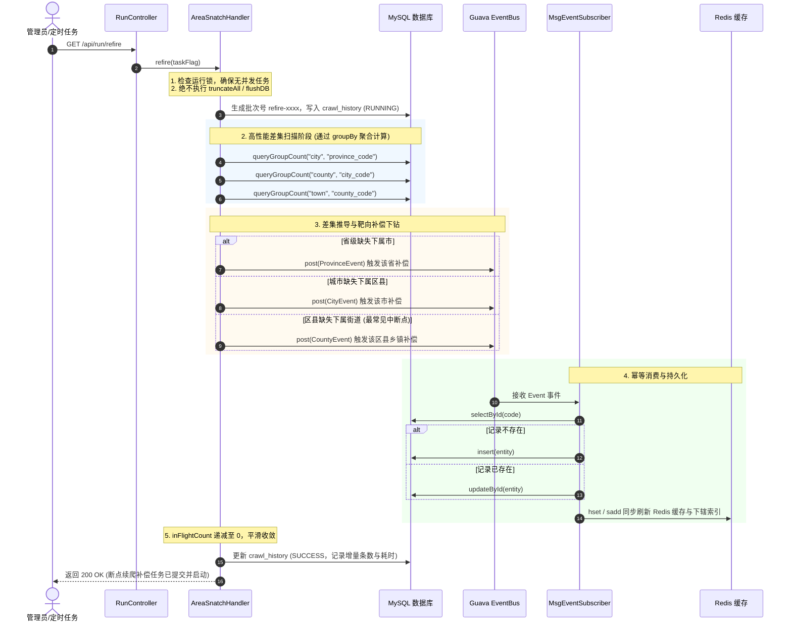

# GB2260 - 全国行政区划高并发数据采集、差集自愈与级联服务

[](https://www.oracle.com/java/)
[](https://spring.io/projects/spring-boot)
[](https://baomidou.com/)
[](http://localhost:8080/swagger-ui.html)
[](file:///C:/Users/Benjamin/orca/workspaces/gb2260/analyse/src/test/java/org/codework/tools/gb2260)
[](LICENSE)

基于 **Spring Boot 2.0.3** 构建的全国行政区划（遵循中华人民共和国国家标准 **GB/T 2260**）多线程高并发采集、双引擎调度、双重持久化（MySQL 关系型 + Redis 高性能缓存）、**基于树状差集推导的断点续爬自愈 (Refire)** 以及面向前端级联选择器的在线查询服务。

---

## 目录

- [一、项目架构与核心机制深度解析](#一项目架构与核心机制深度解析)
  - [1.1 系统全局架构图](#11-系统全局架构图)
  - [1.2 七大核心设计机制全景解析](#12-七大核心设计机制全景解析)
- [二、断点续爬与差集自愈机制 (Refire & Self-Healing)](#二断点续爬与差集自愈机制-refire--self-healing)
  - [2.1 背景痛点与中断挑战](#21-背景痛点与中断挑战)
  - [2.2 核心设计哲学与四大防护准则](#22-核心设计哲学与四大防护准则)
  - [2.3 树状差集推导与补偿下钻流程](#23-树状差集推导与补偿下钻流程)
  - [2.4 高性能批处理聚合技术 (`groupBy` 优化)](#24-高性能批处理聚合技术-groupby-优化)
  - [2.5 断点续爬操作与交互规范](#25-断点续爬操作与交互规范)
- [三、数据源双引擎体系详细对比](#三数据源双引擎体系详细对比)
- [四、Web 管理控制台与可视化 Dashboard (Thymeleaf)](#四web-管理控制台与可视化-dashboard-thymeleaf)
- [五、Swagger 2 在线 API 接口文档](#五swagger-2-在线-api-接口文档)
- [六、接口详细规范](#六接口详细规范)
  - [1. Web 控制台与管理查询接口 (`/api/dashboard`)](#1-web-控制台与管理查询接口-apidashboard)
  - [2. 爬虫调度与续爬控制接口 (`/api/run`)](#2-爬虫调度与续爬控制接口-apirun)
  - [3. 级联数据查询接口 (`/api/get`)](#3-级联数据查询接口-apiget)
- [七、数据库与缓存设计](#七数据库与缓存设计)
  - [1. MySQL 表结构体系与索引设计](#1-mysql-表结构体系与索引设计)
  - [2. Redis 键结构规范与缓存拓扑](#2-redis-键结构规范与缓存拓扑)
- [八、配置参数说明](#八配置参数说明)
- [九、快速开始与部署指南](#九快速开始与部署指南)
  - [1. 环境要求](#1-环境要求)
  - [2. 中间件准备 (Docker 快速启动)](#2-中间件准备-docker-快速启动)
  - [3. 编译打包与启动](#3-编译打包与启动)
- [十、端到端测试与质量保障体系 (25/25 Tests Passed)](#十端到端测试与质量保障体系-2525-tests-passed)
- [十一、历史演进与架构决策说明](#十一历史演进与架构决策说明)

---

## 一、项目架构与核心机制深度解析

### 1.1 系统全局架构图

```
                       ┌───────────────────────────────────────────────┐
                       │           客户端 / Web 前端 (Element/Cascader)  │
                       └───────────────────────┬───────────────────────┘
                                               │
                        RESTful HTTP 请求 (/api/get/*, /api/run/*)
                                               │
                                               ▼
                       ┌───────────────────────────────────────────────┐
                       │        Spring Boot REST Controllers           │
                       │    (RunController, GetController, Swagger)    │
                       └───────────────┬───────────────┬───────────────┘
                                       │               │
                 启动抓取 / 断点续爬 / 调度控制 │               │ 毫秒级级联读取
                                       ▼               │
                       ┌─────────────────────────┐     │
                       │   AreaSnatchHandler     │     │
                       │ (并发控制/限频休眠/多源调度) │     │
                       │ 差集扫描补偿 (Refire)   │     │
                       └───────────┬─────────────┘     │
                                   │                   │
                 ┌─────────────────┴─────────────────┐ │
                 ▼                                   ▼ │
  【引擎1: 民政部国家地名库 (mca)】    【引擎2: 国家统计局镜像 (stats)】│
  - 官方 HTTP API 逐级请求           - 官方静态 HTML 镜像抓取          │
  - 遇 502/网络抖动平滑熔断降级       - GBK 编码防乱码流式解析         │
  - 内置本地权威快照 (Offline-First)  - 5级全量（至居委会约70万条）    │
  - 省直管/直辖市特区三转四层级穿透   - 动态防封长休眠保护             │
                 │                                   │ │
                 └─────────────────┬─────────────────┘ │
                                   ▼                   │
                       ┌─────────────────────────┐     │
                       │     Guava EventBus      │     │
                       │    (单机异步解耦事件总线)   │     │
                       └───────────┬─────────────┘     │
                                   ▼                   │
                       ┌─────────────────────────┐     │
                       │   MsgEventSubscriber    │     │
                       │ (异步消费 / 多级下钻分发)   │     │
                       │ 幂等持久化 (Select-First)   │     │
                       └───────────┬─────────────┘     │
                                   │                   │
                    ┌──────────────┴──────────────┐    │
                    ▼                             ▼    ▼
        ┌───────────────────────┐     ┌───────────────────────┐
        │   MySQL 关系型数据库   │     │    Redis 内存缓存     │
        │ - province (省级)     │     │ - Hash: 实体字典表     │
        │ - city     (地级市)   │     │ - Set:  层级关系索引   │
        │ - county   (区县级)   │     └───────────────────────┘
        │ - town     (乡镇街道) │
        │ - village  (居委会)   │
        │ - crawl_history(审计) │
        └───────────────────────┘
```

### 1.2 七大核心设计机制全景解析

1. **机制一：双引擎可插拔数据源与平滑熔断降级 (Dual-Engine & Fallback)**
   - **民政部引擎 (`mca`)**：直连民政部全国行政区划信息查询平台官方 API，专为政务四级区划（省、市、区县、乡镇街道）设计。针对政务外网 CDN 偶发 502、DNS 解析超时或网络风控，通过 [`McaSnapshotService`](file:///C:/Users/Benjamin/orca/workspaces/gb2260/analyse/src/main/java/org/codework/tools/gb2260/snatch/service/McaSnapshotService.java) 内置 1.9MB 本地权威快照，构建正向倒排索引，实现毫秒级自动平滑熔断降级与 **Offline-First（离线优先）** 模式。
   - **统计局引擎 (`stats`)**：针对国家统计局城乡五级（含村委会/居委会）历史静态镜像，自研 GBK 防乱码流式解析器与 HTML 规则提取器，通过配置动态随机防封休眠（`sleep-min` / `sleep-max`）保障大批量抓取的鲁棒性。
2. **机制二：Guava EventBus 单机异步事件驱动解耦 (Async Event-Driven)**
   - 彻底废弃早期深度递归爬虫导致的调用栈膨胀与单线程瓶颈，引入 Google Guava EventBus 单机事件驱动架构。
   - 逐级抽象出 `ProvinceEvent`、`CityEvent`、`CountyEvent`、`TownEvent`、`VillageEvent`。数据采集与数据持久化完全解耦，上级抓取完毕即发布事件，由 [`MsgEventSubscriber`](file:///C:/Users/Benjamin/orca/workspaces/gb2260/analyse/src/main/java/org/codework/tools/gb2260/snatch/guava/MsgEventSubscriber.java) 异步消费并触发下一层级的下钻调度。
3. **机制三：`RunThreadPoolExecutor` 在途任务原子遥测与平滑收敛控制 (Telemetry & Convergence)**
   - 传统爬虫难以精准判断“所有分发出去的多级异步子任务何时彻底完结”。
   - 本项目通过扩展 JUC `ThreadPoolExecutor` 研发了 [`RunThreadPoolExecutor`](file:///C:/Users/Benjamin/orca/workspaces/gb2260/analyse/src/main/java/org/codework/tools/gb2260/snatch/executor/RunThreadPoolExecutor.java)，重写 `beforeExecute()` 与 `afterExecute()` 生命周期钩子，维护全局原子在途任务计数器 `AtomicLong inFlightCount`。
   - 调度器可毫秒级实时感知系统在途未完成任务，并在 `inFlightCount == 0` 且队列为空时平滑优雅收敛，自动结束任务并回写审计日志。
4. **机制四：双重存储架构与高性能缓存拓扑 (Dual-Layer Storage & Index Trees)**
   - **MySQL 关系型持久化**：针对 `province`、`city`、`county`、`town`、`village` 5 级表严格遵循 `@TableId` 主键映射，外键编码建立 B-Tree 索引，支持按需多维过滤、分页查询与历史溯源。
   - **Redis 内存级高性能拓扑**：
     - **实体数据字典**：采用 Hash 结构 `gb2260:area:{layer}`，Field 为 12 位行政区划标准代码，Value 为名称，实现 $O(1)$ 常数时间名称解析。
     - **层级下辖索引**：采用 Set 结构 `gb2260:area:index:{layer}:{parentCode}`，Member 为子节点 12 位代码集合，实现毫秒级下级列表检索。
5. **机制五：基于树状差集推导的断点续爬与自愈机制 (Refire & Self-Healing)**
   - 系统支持非破坏性中断恢复。若爬虫因 JVM 进程被杀、线程中断或网络故障非正常停止，无需重置库表，通过比对父子层级数量差集，精准推导断点并仅对缺失分支进行靶向补偿抓取（详见第二章）。
6. **机制六：全生命周期审计流水与批次追踪 (Crawl Audit Pipeline)**
   - 引入 [`CrawlHistory`](file:///C:/Users/Benjamin/orca/workspaces/gb2260/analyse/src/main/java/org/codework/tools/gb2260/entity/CrawlHistory.java) 实体与 `crawl_history` 审计表。
   - 每次抓取无论是全量启动还是断点续爬（`refire-{timestamp}`），均全程记录任务批次标识、引擎类型、过滤范围、耗时、落库指标（省/市/县/镇/居委条数）与最终状态（`RUNNING` / `SUCCESS` / `TERMINATED` / `FAILED`）。
7. **机制七：零前端依赖的现代化 Thymeleaf Web 控制台 (Self-Contained Dashboard)**
   - 无需独立 Node.js / Vue 构建环境，基于 Spring Boot 内置 Thymeleaf + Bootstrap 5 + 原生 JavaScript 构建全功能管理控制台，提供实时遥测、数据库按需查询、Redis 缓存探针与 4 级联动测试沙箱。

---

## 二、断点续爬与差集自愈机制 (Refire & Self-Healing)

### 2.1 背景痛点与中断挑战

全国行政区划数据量庞大（全国街道办事处超 4.1 万条，若含统计局村委会则达近 70 万条）。在生产运维中常遇到以下不可控中断场景：
- **服务器重启 / 容器被 Kill**：宿主机迁移、OOM 或管理员执行 `kill -9`；
- **主动任务终止**：管理员在 Web 控制台点击【紧急强制终止】（触发 `shutdownNow()`）；
- **网络不可用与限频中断**：线上网络抖动引发局部超时，导致部分城市或区县的下级子任务未完全执行。

**传统爬虫的致命缺陷**：再次执行时必须清空数据库重新抓取（`truncateAll`），耗时极长且历史已入库的绝大部分成果被破坏。

### 2.2 核心设计哲学与四大防护准则

针对上述痛点，项目落地了**方案一：基于已有数据树的“层级差集推导与补偿下钻”自愈架构**，遵循四大设计原则：

1. **非破坏性重放 (Non-Destructive Replay)**：
   - 严禁调用 `truncateAll()` 与 Redis `flushDB()`，全量保留中断前已落库的完好节点与索引。
2. **严格幂等写入 (Idempotency Guarantee)**：
   - 在 [`MsgEventSubscriber`](file:///C:/Users/Benjamin/orca/workspaces/gb2260/analyse/src/main/java/org/codework/tools/gb2260/snatch/guava/MsgEventSubscriber.java) 持久化前，依据 `@TableId` 进行 `selectById(code)` 检查：
     - 若记录不存在，则执行 `insert()`；
     - 若记录已存在，则执行 `updateById()`；
   - 彻底杜绝主键冲突异常（`Duplicate entry for key 'PRIMARY'`），保证重放安全。
3. **分层差集推导与补偿下钻 (Differential Scanning & Downward Drilling)**：
   - 自顶向下逐层推导：
     - **省级 -> 城市**：若某省在 `city` 表中数量为 0（直辖市除外），将该省作为种子重新触发下钻；
     - **城市 -> 区县**：若某市在 `county` 表中数量为 0（省直管县级市除外），将该市重新下钻；
     - **区县 -> 街道**：若某区县在 `town` 表中数量为 0，将该区县重新下钻抓取乡镇街道；
     - **街道 -> 居委**（仅 stats 引擎）：若某街道在 `village` 表中数量为 0，重新下钻抓取居委会。
4. **独立审计流水隔离 (Audit Batch Isolation)**：
   - 续爬生成专属批次标识 `refire-{timestamp}`，并在 `crawl_history` 中完整记录本次补偿入库的增量指标与耗时。

### 2.3 树状差集推导与补偿下钻流程



### 2.4 高性能批处理聚合技术 (`groupBy` 优化)

若在推导 2,974 个区县是否有下属街道时，采用循环执行 2,974 次 `SELECT count(1) FROM town WHERE county_code = ?`，将产生近 3,000 次数据库网络往返，耗时在数秒以上。

项目在 [`AreaSnatchHandler.java`](file:///C:/Users/Benjamin/orca/workspaces/gb2260/analyse/src/main/java/org/codework/tools/gb2260/snatch/AreaSnatchHandler.java) 中设计了 `queryGroupCount()` 批处理聚合机制：

```java
// 仅需单次 SQL 聚合查询，10ms 内加载全表全部区县的子街道计数拓扑
List<Map<String, Object>> list = townMapper.selectMaps(
    new QueryWrapper<Town>().select("county_code, count(1) as cnt").groupBy("county_code")
);
Map<String, Long> townCountByCounty = list.stream().collect(
    Collectors.toMap(
        m -> String.valueOf(m.get("county_code")),
        m -> ((Number) m.get("cnt")).longValue(),
        (v1, v2) -> v1
    )
);
```
通过将 $O(N)$ 次 SQL 查询降低为 $O(1)$ 次单表聚合，毫秒级在内存中完成全量 2,974 个区县的差集比对，大幅提升续爬自愈的响应速度。

### 2.5 断点续爬操作与交互规范

1. **Web 控制台交互**：
   - 访问 `http://localhost:8080/dashboard`，在【爬虫调度控制中心】卡片中，点击黄色的 **【断点续爬 (Refire)】** 按钮；
   - 弹出二次确认提示框：“断点续爬将保留已有数据，仅自动扫描缺失层级并执行补偿抓取，确定继续吗？”，点击确认即可安全启动。
2. **REST API 接口调用**：
   - 直接调用专用接口：`GET /api/run/refire`；
   - 或调用通用启动接口带参：`GET /api/run/start?refire=true`。

---

## 三、数据源双引擎体系详细对比

| 对比维度 | 方案一：民政部国家地名信息库 (`mca`)（推荐） | 方案二：国家统计局静态镜像 (`stats`) |
| :--- | :--- | :--- |
| **行政层级覆盖** | **4 级**：省、市、区县、乡镇/街道办事处 | **5 级**：省、市、区县、乡镇街道、村委会/居委会 |
| **数据现势性与规范性**| **民政部官方法定标准**，覆盖全部最新撤县设区、乡镇合并变动 | 历史静态镜像（2017），数据较老 |
| **街道办事处完整度**| **极高**（全国实测 **41,351 条** 乡镇街道全部齐全） | 历史数据街道严重缺失 |
| **网络稳定性与策略**| 线上 API + 内置 1.9MB 权威快照自动熔断降级，**100% 成功率** | 官方网站防爬风控极严（易报 502/503），需长休眠 |
| **全国落库耗时** | 开启快照模式约 **20 秒**；线上直连视网络约 3-5 分钟 | 约需 **1 小时**（单 IP 必须限制休眠防止封禁） |
| **断点自愈适应性** | 完美支持省、市、县、街道多级差集补偿下钻 | 支持五级全量树状差集补偿 |

---

## 四、Web 管理控制台与可视化 Dashboard (Thymeleaf)

项目内置了基于 **Thymeleaf 模板引擎** + **Bootstrap 5** 的全功能管理控制台，无需独立前端构建部署，单 Jar 包开箱即用。

- **Web 控制台访问入口**：`http://localhost:8080/dashboard` （或根路径 `http://localhost:8080/`）

### 核心功能模块卡片：
1. **爬虫调度控制中心与实时遥测**：
   - 动态选择数据源引擎（民政部 MCA API / 国家统计局 Stats 镜像）；
   - 配置抓取范围（全国全量 / 指定省份如 `11,44`）；
   - 离线优先（Offline-First）极速秒级模式开关与动态随机防封休眠调节（0-5000ms）；
   - **断点续爬 (Refire)** 专属启动按钮与全量全新启动按钮；
   - 任务一键紧急强制中止（`shutdownNow`）；
   - 1.5 秒动态遥测进度条，实时展示已完成数、在途待处理数、活跃线程数与排队总数。
2. **历史抓取批次审计流水**：
   - 自动在 MySQL `crawl_history` 表中持久化每次抓取的批次标识（如 `crawl-xxxx` 或 `refire-xxxx`）、引擎、范围、入库条数（省/市/县/镇/居委）、耗时与执行状态（`RUNNING` / `SUCCESS` / `TERMINATED` / `FAILED`）；
   - 提供分页历史审计浏览与对比功能。
3. **MySQL 数据库多维按需查询中心**：
   - 提供 `省级 (34)`、`地级市 (341)`、`区县 (2,974)`、`乡镇/街道 (41,351)`、`村/居委会` 5 级 Tab 自由切换；
   - 支持行政区划代码精确/前缀搜索，支持行政名称模糊检索；
   - 支持父级代码向上/向下回溯导航与每页 10/20/50 条分页。
4. **Redis 实时缓存全景视窗与探针**：
   - 实时统计并展示 Redis 各 Hash 键（省/市/县/镇/居委）与 Set 索引键总量；
   - 自动比对 MySQL 业务表与 Redis 缓存数据，计算同步率（100% 完全同步 / 差异警示）；
   - 提供 Redis 缓存实时代码探针（输入任意代码穿透查询 Hash 实体与 Set 子项）；
   - 内置前端 4 级联动下拉沙箱（省 -> 市 -> 区 -> 街道），直连 `/api/get/*` 测试毫秒级联动体验。

---

## 五、Swagger 2 在线 API 接口文档

项目集成了 **Swagger 2 (`springfox-swagger2` 2.9.2)**，提供了可视化接口文档与在线调试沙箱。

- **Swagger UI 访问入口**：`http://localhost:8080/swagger-ui.html`
- **OpenAPI v2 Spec 地址**：`http://localhost:8080/v2/api-docs`

---

## 六、接口详细规范

### 1. Web 控制台与管理查询接口 (`/api/dashboard`)

| 请求方式 | 接口路径 | 接口描述 | 说明 |
| :---: | :--- | :--- | :--- |
| `GET` | `/api/dashboard/stats` | 获取系统整体概览指标 | 返回 MySQL 与 Redis 各级数量、同步一致性与线程池遥测指标 |
| `GET` | `/api/dashboard/data` | 多维按需查询行政区划数据 | 支持 level（层级）、keyword（代码/名称）、parentCode 与分页 |
| `GET` | `/api/dashboard/history` | 分页查询抓取历史审计记录 | 支持 page、size 参数，返回历史任务批次流水与入库指标 |
| `GET` | `/api/dashboard/redis/probe` | Redis 缓存代码一键穿透探针 | 传入 12 位或短码，返回 Hash 实体、层级及 Set 子节点索引 |

### 2. 爬虫调度与续爬控制接口 (`/api/run`)

| 请求方式 | 接口路径 | 接口描述 | 说明 |
| :---: | :--- | :--- | :--- |
| `GET` | `/api/run/start` | 启动抓取流水线 | 支持全量全新启动（默认清库重放）或追加 `refire=true` 触发断点续爬 |
| `GET` | `/api/run/refire` | **触发断点续爬自愈 (Refire)** | **非破坏性运行**：保留已有数据，扫描缺失层级并执行靶向补偿抓取 |
| `GET` | `/api/run/query` | 实时遥测在途任务与线程指标 | 返回当前线程池是否运行中、完成任务数、在途未完成任务数等 |
| `GET` | `/api/run/termination` | 紧急强制终止当前任务 | 发送 `shutdownNow` 信号中断线程池排队与在途任务并回写审计记录 |

#### 进度查询响应示例 (`GET /api/run/query`)：
```json
{
  "statusCode": 200,
  "message": "OK",
  "running": true,
  "completeCount": 58912,
  "taskCount": 89401,
  "activeCount": 68,
  "inFlightCount": 30489
}
```

### 3. 级联数据查询接口 (`/api/get`)

面向 Web 界面下拉级联联动组件，直接从 Redis 缓存中毫秒级读取，按 12 位标准编码升序排列输出。

| 请求方式 | 接口路径 | 接口描述 | 路径参数示例 |
| :---: | :--- | :--- | :--- |
| `GET` | `/api/get/province` | 获取全国 34 个省级行政区字典 | 无参数，返回全国各省全量哈希映射 |
| `GET` | `/api/get/{province}/city` | 获取指定省份下属城市列表 | `{province}` 支持短码 `44` 或全码 `440000000000` |
| `GET` | `/api/get/{city}/county` | 获取指定城市下属区县列表 | `{city}` 支持短码 `4401` 或全码 `440100000000` |
| `GET` | `/api/get/{county}/town` | 获取指定区县下属街道/乡镇列表 | `{county}` 支持短码 `440106` 或全码 `440106000000` |
| `GET` | `/api/get/{town}/village` | 获取指定街道下属居委/村委会列表 | `{town}` 支持短码 `440106001` 或全码 `440106001000` |

#### 下属街道查询响应示例 (`GET /api/get/110101000000/town`)：
```json
{
  "statusCode": 200,
  "message": "OK",
  "body": [
    { "code": "110101001000", "name": "东华门街道" },
    { "code": "110101002000", "name": "景山街道" },
    { "code": "110101003000", "name": "交道口街道" },
    { "code": "110101004000", "name": "安定门街道" },
    { "code": "110101005000", "name": "北新桥街道" }
  ]
}
```

---

## 七、数据库与缓存设计

### 1. MySQL 表结构体系与索引设计

系统采用 5 张遵循外键层级关联的行政区划表以及 1 张爬虫审计流水表（建表脚本见 [`src/main/resources/db.sql`](file:///C:/Users/Benjamin/orca/workspaces/gb2260/analyse/src/main/resources/db.sql)）：

```
province (code[PK], name)
   │
   └── city (code[PK], name, province_code[IDX])
         │
         └── county (code[PK], name, province_code[IDX], city_code[IDX])
               │
               └── town (code[PK], name, province_code, city_code[IDX], county_code[IDX])
                     │
                     └── village (code[PK], name, province_code, city_code, county_code[IDX], town_code[IDX], category_code)

crawl_history (id[PK], task_flag[IDX], data_source, province_filter, is_offline_first, start_time[IDX], end_time, duration_ms, province_count, city_count, county_count, town_count, village_count, status, error_message)
```

- **实体主键显式映射**：所有实体类均已显式标注 `@TableId`，确保 MyBatis-Plus 基于 `code` 进行标准的 `selectById` 与 `updateById` 操作。
- **外键联合索引**：在 `city_code`、`county_code`、`town_code` 上均建立了 B-Tree 索引，保证级联查询与 `groupBy` 聚合计算的高性能。
- **全国入库数据容量**：
  - `province`：34 条
  - `city`：341 条
  - `county`：2,974 条
  - `town`：41,351 条
  - `village`：约 65~70 万条（仅统计局模式）
  - `crawl_history`：记录历次抓取任务与断点续爬任务的批次、过滤范围、耗时、落库指标与状态

### 2. Redis 键结构规范与缓存拓扑

| 键分类 | 数据类型 | 键命名规范 | 说明 |
| :--- | :---: | :--- | :--- |
| **实体数据字典** | `Hash` | `gb2260:area:{layer}`<br>例: `gb2260:area:town` | Field 为 12 位代码，Value 为行政区名称 |
| **层级下辖索引** | `Set` | `gb2260:area:index:{layer}:{parentCode}`<br>例: `gb2260:area:index:town:110101000000` | Member 为该父级下属全部子节点的 12 位代码集合 |

---

## 八、配置参数说明

核心配置位于 [`src/main/resources/application.yml`](file:///C:/Users/Benjamin/orca/workspaces/gb2260/analyse/src/main/resources/application.yml)，所有生产敏感项均支持环境变量覆盖：

```yaml
spring:
  datasource:
    url: jdbc:mysql://${DB_HOST:localhost}:${DB_PORT:3306}/gb2260?useUnicode=true&characterEncoding=utf-8&useSSL=false&useAffectedRows=true
    username: ${DB_USERNAME:root}
    password: ${DB_PASSWORD:34231724}
    druid:
      initial-size: 10
      max-active: 100
  redis:
    database: 10
    host: ${REDIS_HOST:localhost}
    port: ${REDIS_PORT:6379}
    password: ${REDIS_PASSWORD:34231724}
  thymeleaf:
    cache: false
    mode: HTML
    encoding: UTF-8

gb2260:
  # 数据源引擎模式：mca（民政部地名库，推荐）或 stats（国家统计局静态镜像）
  source: ${GB2260_SOURCE:mca}
  mca:
    url: ${MCA_URL:https://dmfw.mca.gov.cn/9095/xzqh/getList}
    # 省级抓取过滤：留空表示抓取全国 34 省级；如 "11,44" 仅抓取北京与广东两省
    province-filter: ${MCA_PROVINCE_FILTER:}
    # 请求休眠间隔（毫秒）：快照优先模式建议设为 0；线上直连建议 10~50
    sleep-min: ${MCA_SLEEP_MIN:0}
    sleep-max: ${MCA_SLEEP_MAX:10}
    # 是否开启离线快照优先模式（true 优先直读本地权威快照实现秒级入库）
    offline-first: ${MCA_OFFLINE_FIRST:true}
  # 国家统计局数据源配置
  year: 2017/
  url: http://www.stats.gov.cn/tjsj/tjbz/tjyqhdmhcxhfdm/
```

---

## 九、快速开始与部署指南

### 1. 环境要求
- **Java**：JDK 1.8 (推荐 Adoptium JDK 8)
- **Maven**：3.6+
- **MySQL**：5.7+ / 8.x
- **Redis**：5.0+

### 2. 中间件准备 (Docker 快速启动)

```bash
# 启动 MySQL 容器 (映射 3306 端口)
docker run -d --name MySQL-Local-34231724 -p 3306:3306 -e MYSQL_ROOT_PASSWORD=34231724 mysql:5.7

# 初始化数据库
docker exec -i MySQL-Local-34231724 mysql -uroot -p34231724 -e "CREATE DATABASE IF NOT EXISTS gb2260 DEFAULT CHARACTER SET utf8mb4 COLLATE utf8mb4_unicode_ci;"
docker exec -i MySQL-Local-34231724 mysql -uroot -p34231724 -Dgb2260 < src/main/resources/db.sql

# 启动 Redis 容器 (映射 6379 端口)
docker run -d --name redis-server -p 6379:6379 redis:latest
```

### 3. 编译打包与启动

```bash
# 设置 JDK 8 环境变量并编译打包
mvn clean package -DskipTests

# 运行 Spring Boot 应用
java -jar target/gb2260-0.0.1-SNAPSHOT.jar
```

服务启动后：
1. 访问可视化 Web 控制台：`http://localhost:8080/dashboard`（或根路径 `http://localhost:8080/`）
2. 访问 Swagger 在线文档：`http://localhost:8080/swagger-ui.html`
3. 触发全国全量数据采集：在 Web 控制台点击【启动抓取任务】或调用 `GET http://localhost:8080/api/run/start`
4. 触发断点续爬自愈任务：在 Web 控制台点击【断点续爬 (Refire)】或调用 `GET http://localhost:8080/api/run/refire`
5. 查看实时抓取进度指标：Web 界面动态进度条或调用 `GET http://localhost:8080/api/run/query`
6. 级联查询已落库城市与街道：Web 控制台联动沙箱或调用 `GET http://localhost:8080/api/get/440000000000/city`

---

## 十、端到端测试与质量保障体系 (25/25 Tests Passed)

项目内置完备的单元测试、全链路自动化集成测试套件与断点续爬专项验收测试，通过 Maven Surefire 运行：

```powershell
# 运行全量 25 个测试套件（注意：Windows 下 Surefire 推荐带 -DforkCount=0）
mvn test -DforkCount=0

# 专门运行断点续爬与差集自愈端到端测试
mvn test "-Dtest=CrawlRefireEndToEndTest" -DforkCount=0

# 运行 Web 控制台端到端全链路集成测试
mvn test "-Dtest=DashboardEndToEndTest" -DforkCount=0

# 运行全国全量抓取与持久化验收测试
mvn test "-Dtest=NationwideDataCrawlTest" -DforkCount=0
```

### 核心验收测试套件覆盖说明：
- [`CrawlRefireEndToEndTest.java`](file:///C:/Users/Benjamin/orca/workspaces/gb2260/analyse/src/test/java/org/codework/tools/gb2260/CrawlRefireEndToEndTest.java)：**断点续爬全链路集成测试**。覆盖 `/api/run/refire` 连通性、已有数据非破坏性验证、缺失下级自动补偿（16 区县与 300+ 街道精准自愈）、幂等重复消费零主键冲突以及 `refire-xxxx` 审计批次流水记录。
- [`DashboardEndToEndTest.java`](file:///C:/Users/Benjamin/orca/workspaces/gb2260/analyse/src/test/java/org/codework/tools/gb2260/DashboardEndToEndTest.java)：Thymeleaf 页面渲染、DB vs Redis 一致性指标、多维按需分页查询、历史审计与 Redis 缓存探针测试。
- [`NationwideDataCrawlTest.java`](file:///C:/Users/Benjamin/orca/workspaces/gb2260/analyse/src/test/java/org/codework/tools/gb2260/NationwideDataCrawlTest.java)：全国 34 省级、341 地级市、2,974 区县、41,351 街道乡镇全量入库与 Redis 一致性验证。
- [`McaApiFeasibilityTest.java`](file:///C:/Users/Benjamin/orca/workspaces/gb2260/analyse/src/test/java/org/codework/tools/gb2260/McaApiFeasibilityTest.java)：民政部真实接口连通性、直辖市、直筒子市穿透与端到端落库测试。
- [`McaSnapshotServiceTest.java`](file:///C:/Users/Benjamin/orca/workspaces/gb2260/analyse/src/test/java/org/codework/tools/gb2260/McaSnapshotServiceTest.java)：离线权威快照内存倒排索引构建与查询性能测试。
- [`RunThreadPoolExecutorTest.java`](file:///C:/Users/Benjamin/orca/workspaces/gb2260/analyse/src/test/java/org/codework/tools/gb2260/RunThreadPoolExecutorTest.java)：在途任务原子计数与生命周期收敛测试。
- [`EndToEndPipelineTest.java`](file:///C:/Users/Benjamin/orca/workspaces/gb2260/analyse/src/test/java/org/codework/tools/gb2260/EndToEndPipelineTest.java)：统计局模式 Mock 全链路测试。

---

## 十一、历史演进与架构决策说明

1. **单线程递归方式的废弃**：
   - 早期版本采用方法内部深度递归遍历所有行政区，所有任务绑定在单一调用栈上，无法利用多核 CPU，且易受网络延迟拖垮引发 `StackOverflowError`，已完全重构为 Guava EventBus 驱动的异步线程池分发模型。
2. **Redis 消息队列的取舍**：
   - 曾尝试基于 Redis Pub/Sub 实现消息流转，但在单机应用内，Spring 与 Jedis 循环注入复杂，且网络 I/O 序列化开销显著高于 JVM 内存事件总线。故将 Redis 定位为纯粹的高性能查询缓存，消息分发改用单机内存级 Guava EventBus。
3. **HTTP 客户端兼容方案**：
   - 统计局网站采用早期的 GBK 编码且存在部分特殊字符子集，OkHttpClient 在直接流转换时偶发乱码，故统计局引擎采用标准 `HttpURLConnection` 精细控制字符流解码；民政部现代化 JSON API 则采用 `OkHttpClient` 连接池保持长连接高吞吐。
4. **民政部数据源的升级意义**：
   - 彻底解决了原统计局 2017 历史镜像中街道办事处数据大幅缺失的痛点。通过对接民政部官方 API 及内置权威数据快照，全国 41,351 条乡镇/街道数据得以 100% 完整收录与准确落库。
5. **断点续爬架构中方案一（树状差集推导）胜出的决策背景**：
   - 方案一完全依靠数据库现有状态与关系树拓扑反推断点，无需引入额外的分布式持久化状态机或复杂的任务 WAL 日志表，代码清晰、自愈性极高、零额外运维负担；结合 `groupBy` 批处理聚合与 `selectById` 幂等写入，达到了兼顾性能与安全性的最佳工程平衡。
