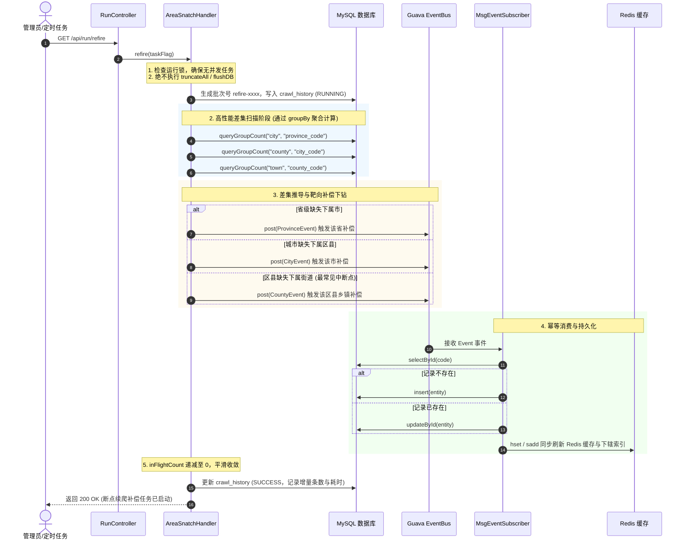

# GB2260 专题文档 02 - 断点续爬与差集自愈机制 (Refire & Self-Healing)

本文档深度剖析系统方案一（基于已有数据树的“层级差集推导与补偿下钻”自愈架构）的产生背景、核心算法、性能批处理优化及操作流程。

---

## 目录

- [一、背景痛点与中断挑战](#一背景痛点与中断挑战)
- [二、四大核心设计原则](#二四大核心设计原则)
- [三、树状差集推导与补偿下钻时序图](#三树状差集推导与补偿下钻时序图)
- [四、高性能批处理聚合技术 (`groupBy` 优化)](#四高性能批处理聚合技术-groupby-优化)
- [五、操作与使用指南](#五操作与使用指南)

---

## 一、背景痛点与中断挑战

全国行政区划数据庞大（全国街道办事处超 4.1 万条，若含统计局村委会则近 70 万条）。在生产环境中，可能会遇到以下不可控中断：
- **服务器重启 / 容器被杀**：宿主机调度、OOM 或管理员执行 `kill -9`；
- **主动任务中止**：管理员在 Web 控制台点击【紧急强制终止】（触发 `shutdownNow()`）；
- **网络不可用与超时**：线上政务外网抖动，导致局部区县或街道下钻任务丢失。

**传统爬虫痛点**：再次执行时必须清空数据库重新全量抓取（`truncateAll`），耗时长达数十分钟且历史完好的绝大部分数据被摧毁。

---

## 二、四大核心设计原则

1. **非破坏性重放 (Non-Destructive Replay)**：
   - 严禁调用 `truncateAll()` 与 Redis `flushDB()`，全量保留中断前已落库的完好节点与索引。
2. **严格幂等写入 (Idempotency Guarantee)**：
   - 在 [`MsgEventSubscriber.java`](file:///C:/Users/Benjamin/orca/workspaces/gb2260/analyse/src/main/java/org/codework/tools/gb2260/snatch/guava/MsgEventSubscriber.java) 持久化前，基于实体类标注的 `@TableId` 进行 `selectById(code)` 检查：
     - 若记录不存在，执行 `insert()`；
     - 若记录已存在，执行 `updateById()`；
   - 彻底杜绝主键冲突（`Duplicate entry for key 'PRIMARY'`），保证重放安全。
3. **分层差集推导与补偿下钻 (Differential Scanning & Downward Drilling)**：
   - 自顶向下逐层推导：
     - **省级 -> 城市**：若某省在 `city` 表中子节点数为 0（直辖市除外），将该省作为种子重新触发下钻；
     - **城市 -> 区县**：若某市在 `county` 表中子节点数为 0（省直管县级市除外），将该市重新下钻；
     - **区县 -> 街道**：若某区县在 `town` 表中子节点数为 0，将该区县重新下钻抓取乡镇街道；
     - **街道 -> 居委**（仅 stats 引擎）：若某街道在 `village` 表中数量为 0，重新下钻抓取居委会。
4. **独立审计流水隔离 (Audit Batch Isolation)**：
   - 续爬生成专属批次标识 `refire-{timestamp}`，在 `crawl_history` 中完整记录本次补偿入库的增量指标与耗时。

---

## 三、树状差集推导与补偿下钻时序图



---

## 四、高性能批处理聚合技术 (`groupBy` 优化)

若在推导全国 2,974 个区县是否有下属街道时，循环执行近 3,000 次 SQL 查询（`SELECT count(1) FROM town WHERE county_code = ?`），将产生数千次网络 I/O，耗时达数秒甚至几十秒。

在 [`AreaSnatchHandler.java`](file:///C:/Users/Benjamin/orca/workspaces/gb2260/analyse/src/main/java/org/codework/tools/gb2260/snatch/AreaSnatchHandler.java) 中设计了 `queryGroupCount()` 批处理聚合机制：

```java
// 仅需单次 SQL 聚合查询，10ms 内加载全表全部区县的子街道计数拓扑
List<Map<String, Object>> list = townMapper.selectMaps(
    new QueryWrapper<Town>().select("county_code, count(1) as cnt").groupBy("county_code")
);
Map<String, Long> townCountByCounty = list.stream().collect(
    Collectors.toMap(
        m -> String.valueOf(m.get("county_code")),
        m -> ((Number) m.get("cnt")).longValue(),
        (v1, v2) -> v1
    )
);
```

通过将 $O(N)$ 次数据库网络查询降低为 $O(1)$ 次单表分组聚合，毫秒级在内存中完成全量 2,974 个区县的差集比对，大幅提升续爬自愈的响应速度。

---

## 五、操作与使用指南

### 1. Web 控制台交互
- 访问 `http://localhost:8080/dashboard`；
- 在【爬虫调度控制中心】卡片中，点击黄色的 **【断点续爬 (Refire)】** 按钮；
- 弹出二次确认提示框：“断点续爬将保留已有数据，仅自动扫描缺失层级并执行补偿抓取，确定继续吗？”，点击确认即可安全启动。

### 2. REST API 接口调用
- 直接调用专用接口：`GET /api/run/refire`；
- 或调用通用启动接口带参：`GET /api/run/start?refire=true`。
